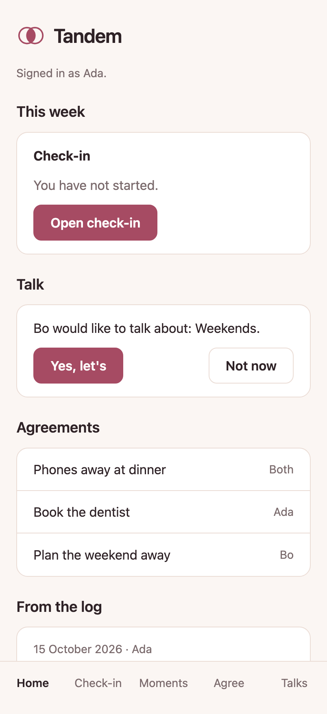
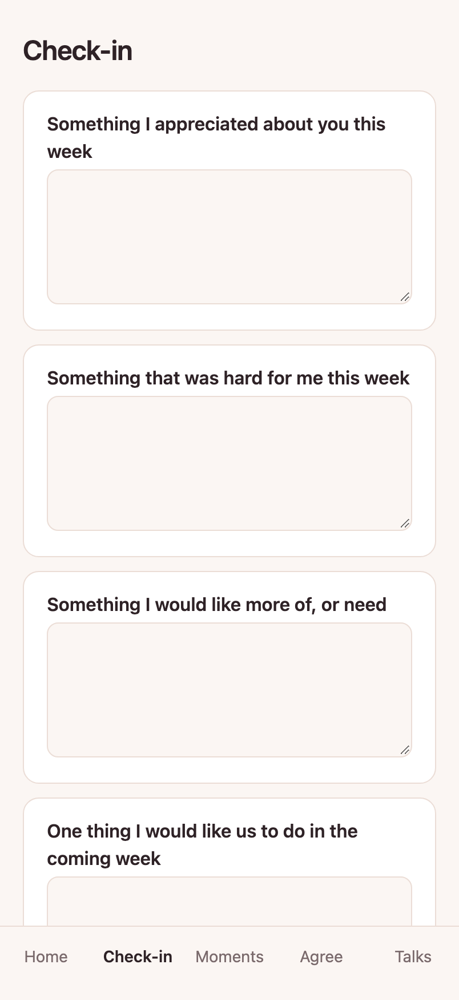
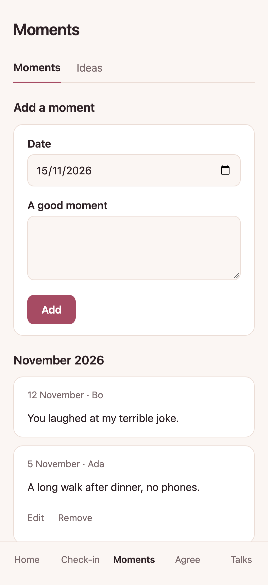
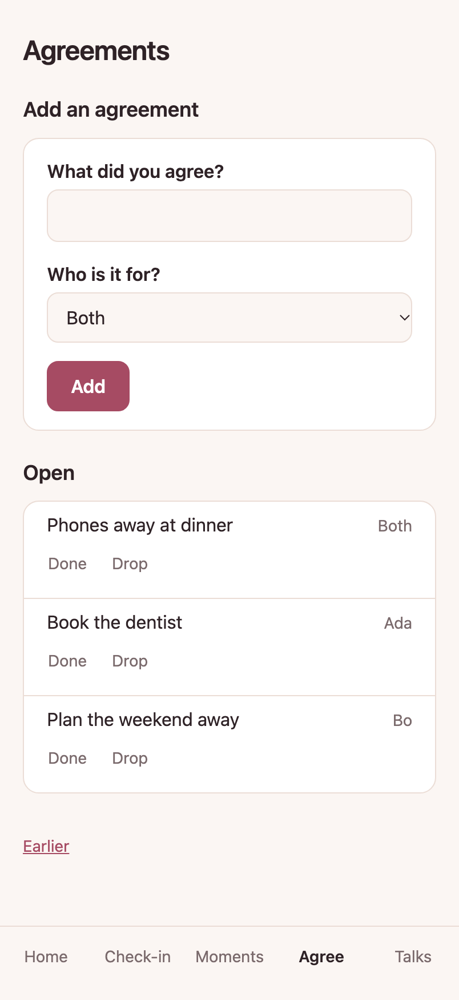
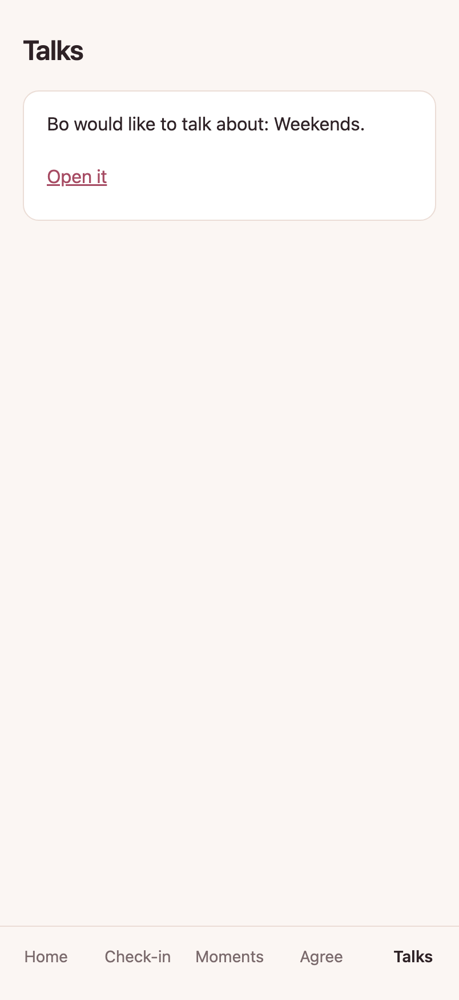
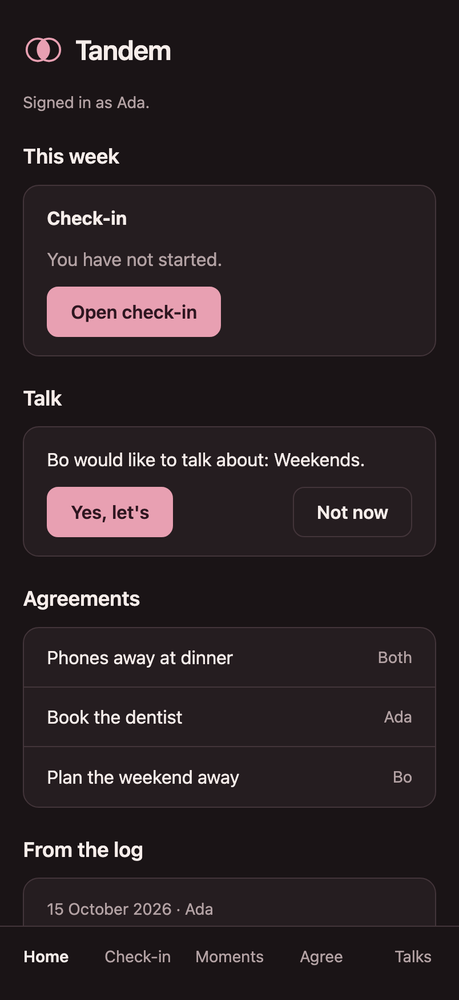
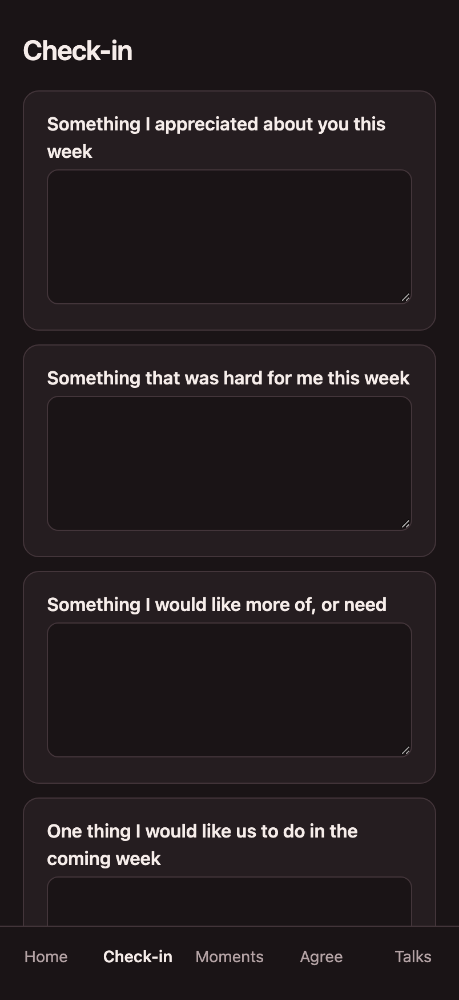
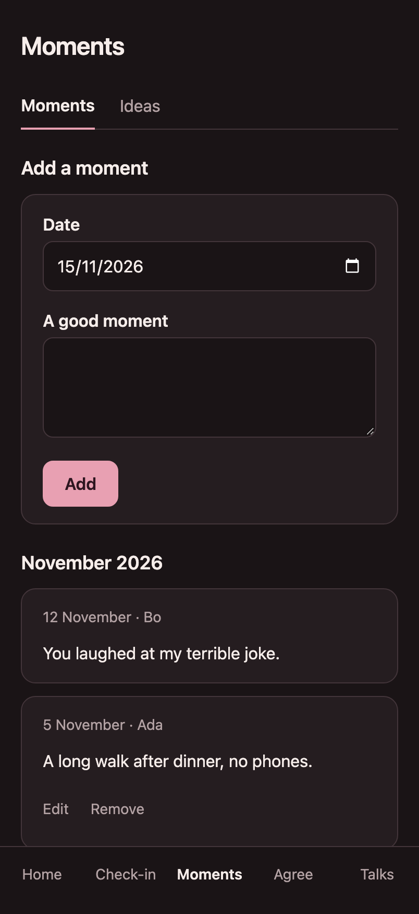
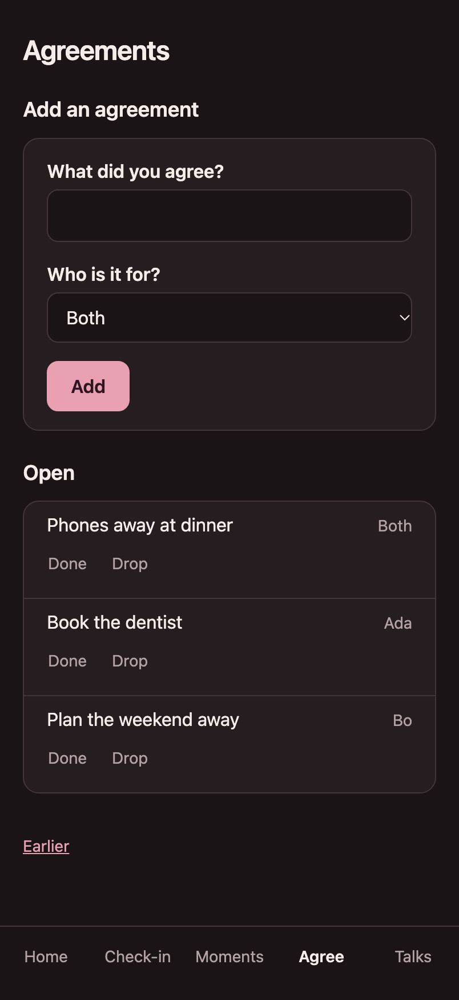
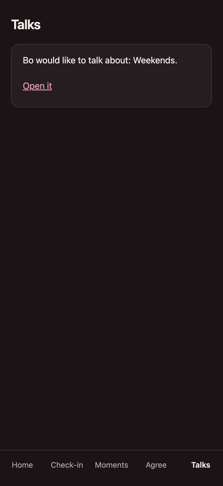

# Tandem

A small private web app for two people. It runs on a home server (a Synology NAS), is opened in Safari on each phone and added to the home screen. It holds four things:

- **Weekly check-in.** Each person answers a few prompts. Neither sees the other's answers until both have submitted.
- **Good moments.** A shared log of small good things, with an ideas list for things to do together.
- **Hard conversations.** A short guided structure for one person to speak and the other to listen. It stores the topic and any agreements that came out of it, never what was said.
- **Agreements.** A list of things the two of you have agreed to, each for one person or both.

There are no scores, streaks or overdue marks. Exactly two people exist, and they are equal: neither has a view, a control or a statistic the other lacks. It works on the home Wi-Fi only; there is no sign up and no access from outside.

Names in the screenshots and tests (Ada and Bo) are invented.

## Screenshots

Light and dark, at phone width.

| Home | Check-in | Moments | Agreements | Talks |
|---|---|---|---|---|
|  |  |  |  |  |
|  |  |  |  |  |

## How it is built

- Node 24, Fastify 5, the built-in `node:sqlite`, server-rendered HTML. The only dependencies are `fastify`, `@fastify/cookie`, `@fastify/formbody` and `@fastify/static`.
- Passphrases are hashed with scrypt. Setup links and session cookies are stored only as SHA-256 hashes. Every state-changing request carries a CSRF token.
- **The privacy rule:** only `src/core/rounds.js` may read the `answers` table, and everything else goes through `rounds.answersVisibleTo`. Tests and mutation checks cover it.
- `src/core/` never imports from `src/routes/` or `src/views/`, and routes run no SQL.
- Logs carry method, path and status only, never request bodies.

An honest limit: whoever looks after the server can open the database file, so the app cannot hide unread answers from them. The welcome screens say so in plain words.

## Run it locally

```bash
npm ci
DATA_DIR=./data node scripts/create-users.mjs Ada Bo   # prints one setup path per person
DATA_DIR=./data node src/server.js                     # http://localhost:8790
```

Open each setup path once, choose a passphrase, and you are signed in. Settings are `PORT`, `DATA_DIR`, `TZ` and `CHECKIN_START_DAY` (0 for Sunday to 6 for Saturday).

## Test

```bash
./scripts/verify.sh          # the one gate: tests, copy rules, colour rule, layering rule
./scripts/verify.sh --fast   # tests only
```

## Deploy

`scripts/deploy.sh` checks the code, sends only committed files over ssh to the host alias `nas`, builds the image there, replaces the container and waits for it to report healthy. `./scripts/deploy.sh --dry-run` prints every command and runs nothing. See [server/README.md](server/README.md) for the first deploy, making the two users, the home screen, backup and day-to-day commands.

## Docs

The design and the build plan live in [docs](docs). They were written in Obsidian, so some links show as `[[Note]]` and the notes carry a small header block.

| Note | What it holds |
|---|---|
| [README](docs/README.md) | Scope decisions, principles and constraints |
| [Architecture](docs/Architecture.md) | Stack, data model, privacy rules, routes, security, NAS deploy |
| [Visual Design](docs/Visual%20Design.md) | Look and feel, tokens, screens, copy rules |
| [Build Plan](docs/Build%20Plan.md) | The ordered tasks, one per commit |
| [Loop Prompt](docs/Loop%20Prompt.md) | The prompt used to build the app one task at a time |
| [Changelog](docs/Changelog.md) | One entry per task or design change |

The app was built one task per commit (`T01: summary`), each gated by `./scripts/verify.sh`. `CLAUDE.md` holds the rules for anyone, or any model, working in the repo.

This is a private project and is not meant for publishing.
